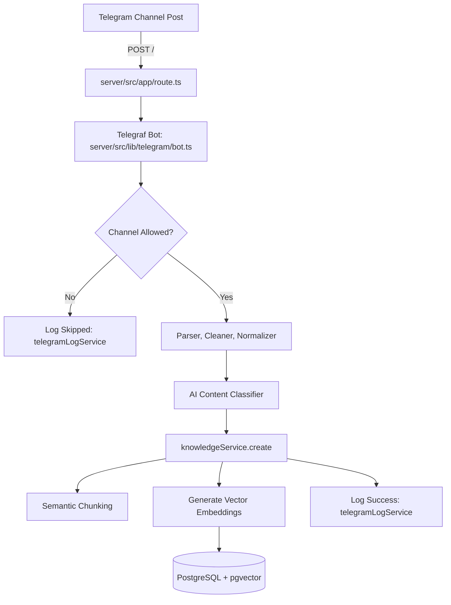

# ATOAI

A self-hosted knowledge ingestion and Retrieval-Augmented Generation (RAG) system. ATOAI ingests posts from Telegram channels via webhooks, Markdown documents, and manual entries via an admin dashboard, generates vector embeddings with `pgvector`, and provides persona-grounded AI conversational answers ("Ato Codes").

---

## 1. System Overview

### What It Does & Who It's For
- **Automated Telegram Knowledge Ingestion**: Captures incoming messages and channel updates in real time, normalizes them, strips formatting artifacts, and classifies content.
- **Vector Search & Storage**: Chunks content and stores 768-dimensional embeddings in PostgreSQL using the `pgvector` extension.
- **RAG Chat**: Retrieves relevant knowledge chunks by cosine similarity and feeds them to an LLM (Gemini or Ollama) using persona-prompting.
- **Admin Dashboard**: Manage documents, inspect chunks, run test queries in a vector playground, monitor Telegram ingestion logs, and configure allowed channel sources.
- **Target Audience**: Maintainers and administrators managing personal or organizational broadcast channels who want a grounded, automated question-answering AI.

### Tech Stack
- **Frameworks & Languages**: TypeScript, Next.js (App Router, v16+), React 19, Tailwind CSS v4.
- **Database & Persistence**: PostgreSQL with `pgvector` extension, Prisma ORM (v7+) with `@prisma/adapter-pg`.
- **Authentication**: Better Auth (Prisma adapter with Bearer plugin).
- **AI & Embeddings**:
  - **Chat LLMs**: Google Gemini (`@google/genai`), Ollama (Local and Cloud).
  - **Embeddings**: Ollama (`embeddinggemma`), Jina AI (`jinaai`), Google Gemini.
- **Telegram Bot**: Telegraf.
- **Package Manager**: pnpm (v12.8.1).

### Project Type
A full-stack monorepo containing two decoupled Next.js applications:
1. `server/`: REST API backend, Telegram webhook consumer, and RAG service (default port: `3000`).
2. `admin.atoai/`: Client-side management console and dashboard (default port: `3001`).

---

## 2. Repository Structure

```text
atoai/
├── package.json          # Root scripts to run both server and admin concurrently
├── docs/                 # In-depth architectural guides and domain documentation
│   ├── project-guide/    # Authoritative system guides, service specs, and workflows
│   └── features/         # Feature specifications (e.g., channel source management)
├── server/               # Backend API and ingestion service (Port 3000)
│   ├── prisma/           # Prisma schema, database migrations, and seed script
│   ├── scripts/          # Batch import scripts (Markdown, Telegram JSON) & manual tests
│   └── src/
│       ├── app/          # Next.js App Router (HTTP routes /api/* and root webhook /)
│       ├── config/       # Environment variable validation via Zod (env.ts)
│       ├── lib/ai/       # AI chat/embedding adapters, RAG pipeline, and system prompts
│       ├── lib/db/       # Prisma client instance and low-level knowledge repositories
│       ├── lib/knowledge/# Telegram/Markdown parsers, cleaners, and normalizers
│       ├── lib/telegram/ # Telegraf bot instance and message handling pipeline
│       ├── module/       # Domain modules: auth, chat, knowledge, sources, telegram-log
│       └── proxy.ts      # CORS and proxy response headers configuration
└── admin.atoai/          # Frontend admin dashboard (Port 3001)
    └── src/
        ├── app/          # Dashboard shell, layouts, and global styles
        ├── features/     # Feature slices (auth, chat, knowledge, search, settings, sources, telegram)
        │   ├── components/ # UI presentation and interaction components
        │   ├── hooks/      # React state and data-fetching hooks
        │   ├── services/   # Typed client-side API callers
        │   └── types/      # Frontend domain interfaces
        └── lib/          # API client (credentials: include) and Better Auth client
```

### Entry Points
- **Server Webhook**: `server/src/app/route.ts` (`POST /` receives incoming Telegram updates).
- **Server API**: `server/src/app/api/` (`/api/chat`, `/api/knowledge`, `/api/auth/[...all]`).
- **Admin Dashboard**: `admin.atoai/src/app/page.tsx` (loads authentication state and tab navigation).
- **Database Seed**: `server/prisma/seed.ts` (seeds initial administrator account).

### Main End-to-End Flow: Telegram Ingestion


### Architecture Patterns
- **Layered Service-Repository**: Distinct domain layers separating HTTP routing, business logic (`services`), and database access (`repositories`).
- **Adapter Pattern for AI Providers**: Common interfaces (`EmbeddingProvider`, `ChatService`) implemented by swappable providers (Ollama, Gemini, Jina).
- **RAG Pipeline**: Semantic query extraction $\rightarrow$ Cosine vector search $\rightarrow$ Context assembly $\rightarrow$ Grounded prompt generation.
- **Feature-Sliced UI**: React features organized by domain with dedicated hooks and typed service wrappers.

---

## 3. Local Setup & Running

### Prerequisites
- Node.js (v20+ or v24)
- `pnpm` (v12.8.1 recommended)
- PostgreSQL database with `pgvector` enabled:
  ```sql
  CREATE EXTENSION IF NOT EXISTS vector;
  ```

### Step-by-Step Setup

1. **Install Dependencies**:
   ```bash
   pnpm install
   ```

2. **Configure Server Environment**:
   ```bash
   cp server/.env.example server/.env
   ```
   Fill in the required values in `server/.env`:
   - `DATABASE_URL`: PostgreSQL connection string.
   - `BETTER_AUTH_SECRET`: Random 32+ character secret string.
   - `INITIAL_ADMIN_EMAIL` & `INITIAL_ADMIN_PASSWORD`: For the seed script.
   - `TELEGRAM_BOT_TOKEN`, `WEBHOOK_SECRET`, `TELEGRAM_CHANNEL_ID`, `TELEGRAM_WEBHOOK_URL`
   - `OLLAMA_API_KEY`, `CLOUD_OLLAMA_MODEL`, `JINA_API_KEY` (required at schema import time).

3. **Configure Admin Environment**:
   ```bash
   cp admin.atoai/.env.example admin.atoai/.env.local
   # Ensure NEXT_PUBLIC_SERVER_URL=http://localhost:3000
   ```

4. **Initialize Database and Seed Admin**:
   ```bash
   cd server
   pnpm prisma generate
   pnpm prisma db push
   pnpm run seed
   cd ..
   ```

5. **Start Development Servers**:
   ```bash
   pnpm run dev
   ```
   - Server: `http://localhost:3000`
   - Admin UI: `http://localhost:3001`

### Linting & Building
```bash
# Lint
pnpm --dir server run lint
pnpm --dir admin.atoai run lint

# Build
pnpm --dir server run build
pnpm --dir admin.atoai run build
```

### Setup Traps to Avoid
- **Missing `pgvector`**: PostgreSQL must have the extension installed or migrations and vector queries will fail.
- **Strict Zod Environment Checks**: `server/src/config/env.ts` validates on startup. Even if only using local Ollama or Gemini, keys for Jina and Ollama Cloud must currently have placeholder strings to pass validation.
- **Vector Dimension Lock**: The Prisma schema sets `vector(768)`. Selected embedding models must produce 768-dimensional vectors.

---

## 4. Health Check & Key Files

### Known Rough Spots
- **API Authorization**: Several backend routes (`/api/knowledge`, `/api/chat`, `/api/telegram/logs`) currently lack server-side session guards.
- **Webhook Verification**: `POST /` does not verify `WEBHOOK_SECRET` or the `X-Telegram-Bot-Api-Secret-Token` header.
- **Testing**: No automated test runner (Jest/Vitest). Manual test scripts exist under `server/scripts/tests/`.

### Top 5 Files to Read First
1. [`server/src/config/env.ts`](server/src/config/env.ts) — Environment variable schema and runtime constraints.
2. [`server/prisma/schema.prisma`](server/prisma/schema.prisma) — Database models and vector configurations.
3. [`server/src/lib/telegram/bot.ts`](server/src/lib/telegram/bot.ts) — Telegram update processing and ingestion pipeline.
4. [`server/src/module/knowledge/service/knowledge.service.ts`](server/src/module/knowledge/service/knowledge.service.ts) — Document storage, chunking, and embedding logic.
5. [`server/src/ai/rag/index.ts`](server/src/ai/rag/index.ts) — RAG search and answer generation flow.

---

## 5. Development Guidelines & Next Steps

### Code Conventions
- **Naming**: Dot-separated or kebab-case for utilities (`knowledge.service.ts`, `telegram.parser.ts`), PascalCase for React components (`KnowledgeTable.tsx`).
- **Commits**: [Conventional Commits](https://www.conventionalcommits.org/) in lowercase imperative mood (e.g. `feat: ...`, `fix: ...`, `refactor: ...`).
- **Branches**: `master` is the primary branch. Create feature branches as `feat/<feature-name>` or `fix/<bug-name>`.

### Recommended First Tasks
1. **Easy**: Add runtime validation for `BETTER_AUTH_SECRET` in `server/src/config/env.ts` and remove fallback secret in `auth.config.ts`.
2. **Medium**: Implement `X-Telegram-Bot-Api-Secret-Token` verification in `server/src/app/route.ts`.
3. **Hard**: Add authentication session guards (`authService.checkAdminStatus`) to protected server API routes.

