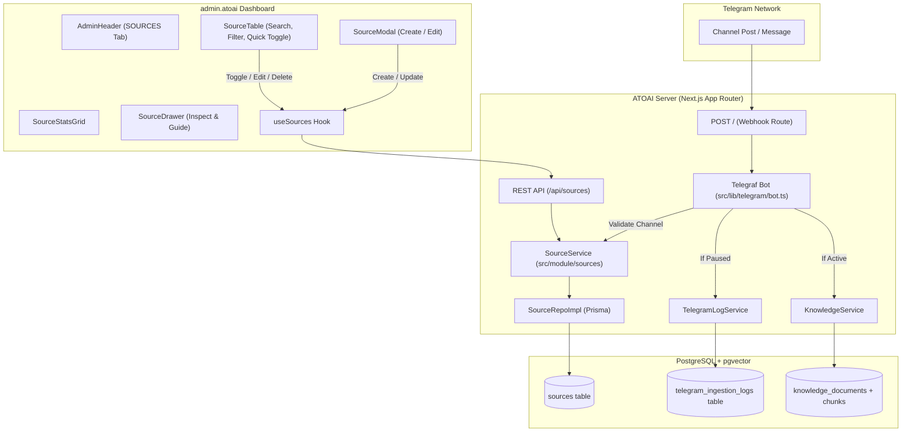

# Sources and Channels Module

This document provides a comprehensive technical breakdown of the **Sources & Channels Module** in ATOAI, covering its purpose, architectural design, database persistence, Telegram ingestion pipeline integration, backend REST endpoints, and the browser admin interface.

---

## 1. Overview and Purpose

ATOAI ingests documents from diverse external channels—most notably Telegram channels and public feeds—into its vector knowledge base for RAG (Retrieval-Augmented Generation). 

Prior to this module, the Telegram bot processed any incoming channel post indiscriminately without source validation or centralized control. The Sources Module introduces:
- **Centralized Source Ledger**: Persistent registry of monitored channels, websites, and external sources.
- **Dynamic Ingestion Control**: Ability to toggle channels between `ACTIVE` and `INACTIVE` (paused) instantly from the dashboard.
- **Pipeline Gatekeeping**: Validation of incoming Telegram updates against configured channels, skipping inactive channels and logging transparent reasons.
- **Auto-Discovery**: Automatic registration of newly connected channels so administrators have immediate visibility and control.
- **Full Admin UI Integration**: Dedicated tab in `admin.atoai` with metrics, search, filtering, 1-click toggles, creation/editing modals, and inspector drawers.

---

## 2. Architectural Flow



---

## 3. Data Model and Schema

Defined in `server/prisma/schema.prisma` and mapped to PostgreSQL table `sources`:

```prisma
enum SourceType {
  TELEGRAM
  WEBSITE
  OTHER
}

enum SourceStatus {
  ACTIVE
  INACTIVE
  ARCHIVED
  DELETED
}

model Source {
  id          String       @id @default(uuid())
  name        String?
  type        SourceType   @default(TELEGRAM)
  status      SourceStatus @default(ACTIVE)
  channelId   String?      @unique @map("channel_id")
  username    String?
  url         String?
  description String?      @db.Text
  metadata    Json?        @default("{}")

  createdAt   DateTime     @default(now()) @map("created_at")
  updatedAt   DateTime     @updatedAt @map("updated_at")

  @@index([type])
  @@index([status])
  @@index([username])
  @@map("sources")
}
```

### Key Field Design Decisions:
- **`channelId` (`String? @unique`)**: Stores the Telegram chat ID (e.g. `-1001928374650`). Stored as a string to avoid JavaScript 64-bit integer overflow issues with JSON serialization. PostgreSQL permits multiple `NULL` values in `@unique` columns, so non-channel sources can leave it unset.
- **`username` (`String?`)**: Normalized Telegram handle without the leading `@`.
- **`url` (`String?`)**: Public link (e.g., `https://t.me/atoai_news` or external feed URL).
- **`status`**: Default `ACTIVE`. When set to `INACTIVE`, incoming ingestion is skipped.
- **Indexes**: Added B-tree indexes on `type`, `status`, and `username` for performant filtering.

---

## 4. Backend Domain Layer (`server/src/module/sources/`)

The module follows the layered architecture established by the existing modules (`knowledge`, `telegram-log`, `auth`).

### Directory Structure
```
server/src/module/sources/
├── index.ts
├── interface/
│   ├── source.interface.ts
│   ├── source.repo.interface.ts
│   └── source.service.interface.ts
├── repo/
│   └── source.repo.impl.ts
└── service/
    └── sources.service.ts
```

### Component Breakdown

#### 1. Interfaces & DTOs ([source.interface.ts](file:///home/atocodes/Projects/atoai/server/src/module/sources/interface/source.interface.ts))
- **`Source`**: Core domain entity.
- **`CreateSourceDTO` / `UpdateSourceDTO`**: Payload contracts ensuring typed mutations.
- **`SourceFilter`**: Query options supporting pagination (`page`, `limit`), `status`, `type`, and `search`.
- **`SourceStats`**: Aggregated counters for totals, active, paused, archived, and source type breakdowns.

#### 2. Repository Interface & Implementation ([source.repo.impl.ts](file:///home/atocodes/Projects/atoai/server/src/module/sources/repo/source.repo.impl.ts))
- **`create()`**: Normalizes usernames (stripping `@`) and channel IDs, setting defaults.
- **`update()`**: Updates fields with clean handles.
- **`delete()`**: Deletes the source record.
- **`findById()`, `findByChannelId()`, `findByUsername()`**: Fast lookups with case-insensitive matching for handles.
- **`findByChannelIdOrUsername()`**: Composite channel resolution.
- **`list(filter)`**: Applies case-insensitive term matching across `name`, `username`, `channelId`, `description`, and `url`, with page skipping and limit clamping (max 100).
- **`getStats()`**: Concurrent `prisma.source.count` queries for fast dashboard telemetry.

#### 3. Service Implementation ([sources.service.ts](file:///home/atocodes/Projects/atoai/server/src/module/sources/service/sources.service.ts))
- **Identifier Normalization**: Automatically extracts usernames from `t.me/<username>` URLs and generates public URLs when only username is supplied.
- **Duplicate Collision Checks**: Proactively checks if another source already uses the same `channelId` or `username` and raises informative errors before persistence.
- **`toggleStatus(id)`**: Atomically switches a source between `ACTIVE` and `INACTIVE`.
- **`isChannelAllowed(channelId, username, title)`**: Pipeline gatekeeper:
  1. Checks if the channel exists in the database.
  2. If found and `ACTIVE`: Ingestion is approved.
  3. If found and `INACTIVE` / `ARCHIVED`: Returns `{ allowed: false, reason: "..." }`.
  4. If not found: Automatically registers the newly observed Telegram channel with status `ACTIVE` and default title, ensuring administrators gain visibility and control over newly connected channels immediately.

---

## 5. Telegram Ingestion Pipeline Integration

File: `server/src/lib/telegram/bot.ts`

Prior to extracting knowledge from incoming channel posts or group messages, the bot queries `sourceService`:

```typescript
// Guard channel source active status
if (chatId || chatUsername) {
  const channelCheck = await sourceService.isChannelAllowed(
    chatId,
    chatUsername,
    chatTitle
  );
  if (!channelCheck.allowed) {
    await telegramLogService.log({
      messageId,
      chatId,
      chatTitle,
      author,
      status: "skipped",
      rawSnippet,
      reason:
        channelCheck.reason ||
        "Channel source is paused/inactive in source configuration.",
      source: sourceName,
      metadata: {
        channelId: chatId,
        username: chatUsername,
        sourceStatus: channelCheck.source?.status,
      },
    });
    console.log(
      `[TelegramBot] Ingestion paused for channel "${chatTitle || chatId}": ${channelCheck.reason}`
    );
    return;
  }
}
```

### Operational Outcomes:
- **Active Channel**: Normalized into `KnowledgeDocument`, embedded into vector chunks, and logged as `success`.
- **Paused Channel**: Execution halts before embedding generation; logged to `telegram_ingestion_logs` as `skipped` with the descriptive reason so operators understand why the post was not ingested.
- **First-time Channel Post**: Auto-registered in `sources` table, allowing administrators to manage or pause it from the UI.

---

## 6. HTTP REST API Surface

| Method | Path | Request Body / Query | Response | Purpose |
|---|---|---|---|---|
| `GET` | `/api/sources` | `?page=1&limit=20&status=all&type=all&search=...` | `{ success: true, sources, total, page, limit }` | Paginated search and filtering of sources. |
| `POST` | `/api/sources` | `{ name, type, status, channelId, username, url, description }` | `{ success: true, source }` (201) | Register a new channel or source. |
| `GET` | `/api/sources/stats` | None | `{ success: true, stats: SourceStats }` | Telemetry counters for sources. |
| `GET` | `/api/sources/[id]` | None | `{ success: true, source }` | Single source detail inspection. |
| `PATCH` | `/api/sources/[id]` | Partial DTO payload | `{ success: true, source }` | Update source configuration. |
| `DELETE` | `/api/sources/[id]` | None | `{ success: true, message: string }` | Remove source. |
| `POST` | `/api/sources/[id]/toggle` | None | `{ success: true, source, message }` | Fast status toggle (`ACTIVE` <-> `INACTIVE`). |

Cross-origin requests from the admin portal (`http://localhost:3001` or configured `ADMIN_URL`) are handled by `server/src/proxy.ts` middleware with credentials.

---

## 7. Admin Frontend Integration (`admin.atoai`)

Directory: `admin.atoai/src/features/sources/`

### Components & State

```
admin.atoai/src/features/sources/
├── index.ts
├── types/
│   └── source.types.ts
├── services/
│   └── source.service.ts
├── hooks/
│   └── useSources.ts
└── components/
    ├── SourceStatsGrid.tsx
    ├── SourceTable.tsx
    ├── SourceModal.tsx
    └── SourceDrawer.tsx
```

#### 1. Custom Hook (`useSources.ts`)
Encapsulates all sources state:
- Automated fetching of stats and paginated table data.
- Search term debouncing and page reset.
- Type (`ALL`, `TELEGRAM`, `WEBSITE`, `OTHER`) and status (`ALL`, `ACTIVE`, `PAUSED`, `ARCHIVED`) filters.
- Optimistic update and refetch triggers for status toggling, deletion, editing, and creation.
- Controls modal and drawer visibility.

#### 2. Telemetry Grid (`SourceStatsGrid.tsx`)
Displays 4 metric cards matching the ATOAI dark terminal design system:
1. **TOTAL SOURCES**: Total count of registered feeds.
2. **ACTIVE INGESTION**: Sources currently accepting updates (green font with glowing live indicator).
3. **PAUSED / INACTIVE**: Muted sources (amber indicator).
4. **TELEGRAM CHANNELS**: Dedicated count of connected Telegram channels.

#### 3. Source Ledger (`SourceTable.tsx`)
High-density responsive data table featuring:
- **Search bar**: Instant query across names, handles, channel IDs, and URLs.
- **Select filters**: Dropdowns for Source Type and Ingestion Status.
- **Identifier column**: Shows `@username` (with external link icon) and numeric `Channel ID`.
- **Status column**: Color-coded pill with pulsating active dot.
- **One-click Toggle**: Quick button to enable or pause ingestion without opening an edit modal.
- **Action buttons**: Inspect (drawer), Edit (modal), and Delete (with confirmation).
- **Empty State**: Guided terminal view with direct "+ Add Your First Channel" call-to-action.
- **Pagination Footer**: Page navigation and total item count.

#### 4. Create & Edit Modal (`SourceModal.tsx`)
- Type selector: Interactive button group (Telegram, Website, Other).
- Form inputs: Display Name, Channel @Username, Channel ID, Public URL, Ingestion Status, and Description.
- Telegram guide alert: Explains how to add the Telegram bot as an administrator to the target channel.
- Built-in validation and duplicate conflict alerts.

#### 5. Inspection Drawer (`SourceDrawer.tsx`)
Right-hand slide-out drawer providing:
- Key attributes grid with copyable Source ID.
- Quick action toolbar (Pause/Enable, Edit, Delete, Open Telegram URL).
- **How Ingestion Works** guide card for channel operators.
- Created and updated timestamp records.
- Expandable raw JSON database entity viewer.

#### 6. Header Navigation (`AdminHeader.tsx`)
- Added `sources` tab with `Layers` icon.
- Full mobile drawer support for responsive smartphone/tablet access.

---

## 8. Telegram Channel Setup Guide for Operators

To connect a Telegram channel to ATOAI:
1. **Create/Identify Bot**: Ensure the Telegram bot is configured in `server/.env` (`TELEGRAM_BOT_TOKEN`).
2. **Add Bot as Channel Admin**:
   - Open your Telegram Channel settings -> Administrators -> Add Administrator.
   - Search for your ATOAI bot handle and grant standard administrative privileges (must be able to receive channel posts).
3. **Register in Dashboard** (Optional but recommended):
   - Navigate to the **SOURCES** tab in the ATOAI Admin dashboard.
   - Click **+ ADD SOURCE**.
   - Enter the Channel Name, `@username` (e.g. `my_tech_channel`), and optional Channel ID.
   - Click **+ CREATE SOURCE**.
4. **Auto-Discovery**:
   - If a channel post is made before manual registration, ATOAI automatically registers the channel as `ACTIVE` upon receiving the first webhook update.
5. **Pause Ingestion**:
   - To temporarily stop receiving updates from a channel without removing the bot, click the **ENABLED / PAUSED** toggle in the Sources table.

---

## 9. Verification & Build Status

- **Type Safety**: Verified with `pnpm tsc --noEmit` across both `server` and `admin.atoai` (0 errors).
- **Backend Build**: `pnpm build` in `server` passed with all dynamic routes compiled.
- **Frontend Build**: `pnpm build` in `admin.atoai` passed with all static and dynamic components compiled.
