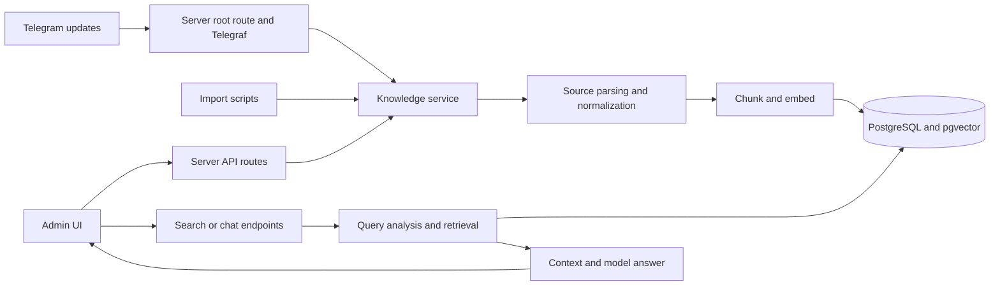

# ATOAI Project Guide

This guide describes the repository as it currently behaves. Source code and configuration are the authority; older READMEs and the root `TECHNICAL_DOCUMENTATION.md` contain stale or overconfident statements in places. See [Known documentation/code differences](#known-documentationcode-differences) before relying on a feature claim.

## System at a glance

ATOAI ingests knowledge from Telegram, import scripts, and the admin UI. The server normalizes and stores full documents and metadata in PostgreSQL, splits content into chunks, obtains embeddings from a configured provider, and stores vectors in pgvector. Search ranks chunks by cosine distance. The chat path retrieves chunks, assembles context, and asks the chat provider for an answer. A separate Next.js admin app calls server routes to manage and inspect the system.

This is a monorepo-like workspace with two independent Next.js apps, not one shared package workspace at the repository root. Each app has its own package manifest and pnpm workspace file.

## Navigation

### Applications

- [Server application](apps/server/README.md) — route map, app layers, configuration, and backend entry points.
- [Server API and request behavior](apps/server/api.md) — HTTP routes, input handling, auth boundaries, and responses.
- [Admin application](apps/admin/README.md) — dashboard shell, client state, API calls, and feature navigation.
- [Admin feature flows](apps/admin/features.md) — how auth, knowledge, search, chat, logs, and settings move through UI state.

### Services and domains

- [Knowledge ingestion and lifecycle](services/knowledge.md) — Telegram/manual/import ingestion, normalization, chunking, re-embedding, and error paths.
- [Search and RAG](services/search-rag.md) — direct vector search and question-answering retrieval pipeline.
- [Authentication](services/authentication.md) — Better Auth setup, initial admin flow, session checking, and current authorization gaps.
- [Telegram ingestion logs](services/telegram-logs.md) — audit records, API and admin log views, and best-effort log persistence.

### Data and operations

- [Data platform](data-platform/README.md) — Prisma models, PostgreSQL, migrations, pgvector, and persistence boundaries.
- [Importers and scripts](operations/importers.md) — batch input formats and side effects.
- [Configuration and local development](operations/development.md) — env validation, app commands, integrations, and discrepancies with READMEs.

### Workflows and study

- [End-to-end workflows](workflows.md) — trace important use cases from entry point through storage and response.
- [Repository navigation and study sequence](study-guide.md) — where to start when learning or changing a feature.

## Known documentation/code differences

These are confirmed by reading the route and service implementations:

| Older claim or implication | Current implementation |
|---|---|
| All knowledge, chat, and telemetry API routes are authenticated/admin-only. | Their shown handlers do not call `authService.checkAdminStatus`; most are currently reachable without that check. Authentication exists in the app, but this is not a global API guard. Inspect each route before assuming protection. |
| The Telegram webhook verifies `WEBHOOK_SECRET`. | `server/src/app/route.ts` parses JSON and calls `bot.handleUpdate`; it does not read or compare the secret. The environment validator requires the variable, but that alone does not enforce it. |
| Telegram live ingestion checks for duplicate source IDs inside `knowledgeService.create`. | `createTelegramKnowledge` checks first, and `KnowledgeService.create` also returns an existing document when found. Database uniqueness remains the final concurrency guard. |
| Classification, smart chunking, and all embedding operations always succeed or fail the whole ingest. | Classifier errors can fail source processing. Chunking has a deterministic fallback. Individual embedding failures are logged and skipped; a document can remain stored with fewer or zero chunks. |
| Generated vectors can be changed to any dimension by environment configuration alone. | Prisma schema stores `vector(768)`; provider output and DB width must agree. Changing dimensions requires schema/index and existing-vector migration/re-embedding work. |
| API search accepts rich filters as a fully validated contract. | The route checks only that `query` is a string. It forwards selected request body fields; validation is uneven across route boundaries. |
| Admin UI “auth gate” implies protected backend resources. | The UI hides the dashboard behind client-side auth state, but API protection must be implemented at the backend route/service boundary independently. |
| Root `TECHNICAL_DOCUMENTATION.md` fully describes current implementation. | It is historical context and contains inaccuracies. Prefer this guide and current source. |
| The app READMEs describe project-specific onboarding. | Both READMEs are mostly create-next-app templates and omit important project-specific setup and behavior. |

The table does not declare intended policy. It records what the checked-in code does at the time this guide was written.
